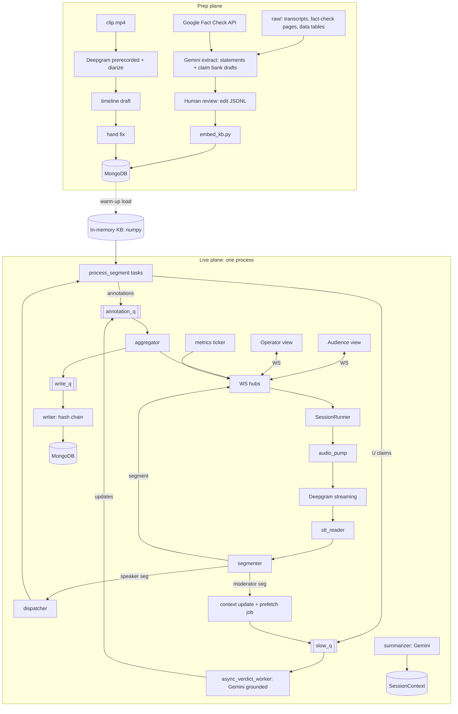
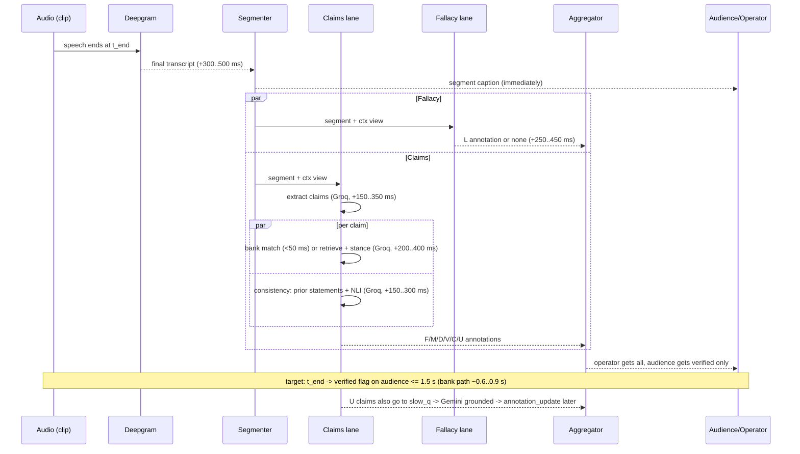
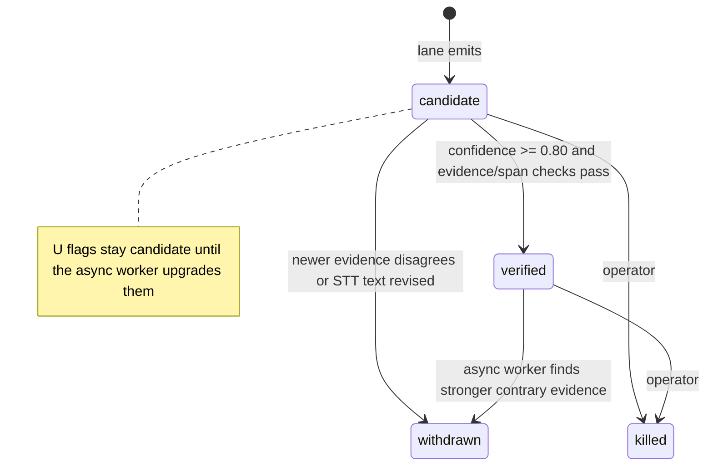

# ARCHITECTURE.md: BS Subtitles

> Companion to `CONTEXT.md` (rules, categories, data contracts, stack). This file defines HOW the
> system runs: processes, tasks, queues, timing, interfaces, prompts, failures, deployment.
> If the two files disagree, `CONTEXT.md` wins on rules; this file wins on structure.

## 1. System overview

Two planes:

- **Prep plane (offline, before the demo):** builds the knowledge base and clip timelines. Slow,
  Gemini-heavy, human-reviewed. Output lives in MongoDB.
- **Live plane (during a session):** one FastAPI process, one asyncio event loop, one `SessionRunner`
  per session. Everything on the hot path is in memory; MongoDB is written asynchronously.



## 2. Runtime model (live plane)

One process: `uvicorn app.main:app --workers 1` (single worker: session state is in memory).

`SessionRunner(session_id, clip_id)` owns:

| Field | Type | Purpose |
|---|---|---|
| `ctx` | `SessionContext` | shared context for all lanes (section 4) |
| `kb` | `KnowledgeBase` | in-memory numpy indexes, loaded at warm-up |
| `annotation_q` | `asyncio.Queue[Annotation]` | lanes and workers -> aggregator |
| `slow_q` | `asyncio.Queue[SlowJob]` | U claims and prefetch jobs -> async worker |
| `write_q` | `asyncio.Queue[Event]` | aggregator and segmenter -> writer |
| `lane_sem` | `asyncio.Semaphore(8)` | caps concurrent `process_segment` tasks |
| `metrics` | `Metrics` | latency samples, bank hits, cache tokens |

Long-lived tasks started by `SessionRunner.start()`:

| Task | Count | Does | Must never |
|---|---|---|---|
| `audio_pump` | 1 | reads clip audio, sends 100 ms PCM chunks to Deepgram at 1x | drift from wall clock (sleep to target time, not fixed intervals) |
| `stt_reader` | 1 | receives Deepgram messages, passes finals to segmenter | block on anything |
| `segmenter` | 1 (inline in stt_reader) | builds sentences, tags speaker/role, emits `Segment` | wait for lanes |
| `dispatcher` | 1 (inline) | `create_task(process_segment(seg))` under `lane_sem` | await lanes |
| `aggregator` | 1 | owns annotation state, applies gates, routes to hubs, enqueues writes | call LLMs or DB |
| `writer` | 1 | drains `write_q`, assigns `seq`, hash chain, batches inserts every 250 ms | run more than once per session |
| `async_verdict_worker` | 2 | Gemini grounded verdicts + prefetch | touch the hot path |
| `summarizer` | 1 | every 6 speaker turns, refresh `ctx.rolling_summary` | block lanes (lanes read the last value) |
| `metrics_ticker` | 1 | every 1 s, push p50/p95/bank_hit_rate/cache tokens to operator | |

Single-writer rule: only `aggregator` mutates annotation state; only `writer` writes the event log;
only `segmenter` and `summarizer` mutate `ctx` (segmenter: turns and question; summarizer: summary).
Lanes read a frozen `ctx.view_for(seg)` snapshot.

## 3. One sentence, end to end (timing)



Important dependency: Lane D (consistency) needs extracted claims, so it runs inside the Claims lane
after extraction, in parallel with stance. Fallacy runs from the raw sentence, in parallel with all of it.

Latency is measured per annotation version:
`latency_ms = emit_wall_time - (session.t0_wall + seg.t_end)`.

## 4. SessionContext (the shared context)

```python
class SessionContext:
    session_id: str
    participants: dict[str, SpeakerDigest]   # speaker_id -> ~300-token digest (name, office, key positions)
    active_topic: str | None                 # set by moderator question
    last_question: Segment | None
    turns: dict[str, deque[Segment]]         # per speaker, last 8 segments
    current_turn_speaker: str | None
    rolling_summary: str                     # <= 200 tokens, refreshed by summarizer
    claim_ledger: dict[str, list[ClaimRecord]]  # per speaker, claims made this session (+ embeddings)

    def view_for(self, seg: Segment, lane: str) -> LaneContext: ...
```

`view_for` returns ONLY what that lane's prompt needs (see table below):

| Lane | Fields in the view |
|---|---|
| claims_extract | last 3 segments of seg.speaker, last_question, rolling_summary, speaker digest |
| claims_stance | the claim only (passages come from the KB) |
| fallacy | seg.speaker's current turn, opponent's last turn, last_question, speaker digest |
| consistency | the claim + top 3 prior statements (from KB + claim_ledger) |

Turn tracking: a turn = consecutive segments from the same speaker. The opponent's last turn = the most
recent completed turn by any other non-moderator speaker.

## 5. Component interfaces

```python
# ingest.py
class AudioPump:
    async def run(self, clip: Clip, dg: DeepgramStream, t0_wall: float) -> None
class TimelineLookup:
    def who(self, t_mid: float) -> tuple[str, Literal["speaker", "moderator"]]

# segmenter.py
class Segmenter:
    def on_final(self, words: list[Word]) -> list[Segment]
    # sentence end = terminal punctuation OR Deepgram utterance_end OR speaker change at word level
    # a speaker change mid-buffer forces a split (never a cross-speaker sentence)

# lanes/claims.py
async def run_claims(seg: Segment, view: LaneContext, kb: KnowledgeBase,
                     emit: Callable[[Annotation], None], slow_q: asyncio.Queue) -> None

# lanes/fallacy.py
async def run_fallacy(seg: Segment, view: LaneContext, emit: Callable[[Annotation], None]) -> None

# lanes/consistency.py
async def run_consistency(claim: Claim, seg: Segment, kb: KnowledgeBase,
                          ledger: list[ClaimRecord], emit: Callable[[Annotation], None]) -> None

# kb/store.py
class KnowledgeBase:
    @classmethod
    async def load(cls, db, speaker_ids: list[str], topics: list[str]) -> "KnowledgeBase"
    def match_bank(self, speaker_id: str, claim: Claim) -> BankHit | None     # cosine >= 0.82 + entity/number overlap
    def search_passages(self, text: str, topic: str | None, k: int = 5) -> list[Passage]
    def search_statements(self, speaker_id: str, text: str, k: int = 3) -> list[Statement]
    def add_passages(self, topic: str, passages: list[Passage]) -> None    # used by prefetch, thread-safe

# llm/client.py
async def groq_json(prompt_id: str, variables: dict, schema: type[BaseModel],
                    timeout: float = 1.2) -> LLMResult      # temp 0, JSON mode, retry once, logs usage
async def gemini_json(prompt_id: str, variables: dict, schema: type[BaseModel],
                      grounded: bool = False, cache_name: str | None = None,
                      timeout: float = 20.0) -> LLMResult

# aggregator.py
class Aggregator:
    async def run(self) -> None
    def is_public(self, a: Annotation) -> bool
    def kill(self, annotation_id: str, by: str) -> None

# eventlog.py
class EventWriter:
    async def run(self) -> None        # single instance per session
```

Embedding calls (`sentence-transformers`) are CPU-bound: run them via `asyncio.to_thread`, and batch
all claims of one segment into one encode call.

## 6. Annotation lifecycle



Each transition = new `version` + an `annotation_update` event. Audience receives an annotation the
first time `is_public()` becomes true, and a removal message if it later becomes withdrawn or killed.

```python
def is_public(a: Annotation) -> bool:
    if a.status != "verified" or a.confidence < AUDIENCE_MIN_CONF: return False
    if a.category == "U": return False
    if a.category == "L": return bool(a.span_text) and (a.subtype != "strawman" or bool(a.opponent_span))
    return len(a.evidence) > 0 and all(e.quote for e in a.evidence)
```

Verification checks done in code before `verified` (never trust the model on these):
- `span_text` is a substring of `seg.text`.
- every `evidence.quote` is a substring of the passage/source text it cites (normalize whitespace and quotes).
- no number or negation word in the span has STT confidence < 0.85.
- the speaker is not the moderator.

## 7. Prompts (files in `llm/prompts/`, hashed at load, versioned in git)

All prompts: static rules first, then speaker digest, then dynamic context, current sentence last.
All outputs: JSON validated by pydantic. Temperature 0.

| Prompt id | Provider | Input | Output schema |
|---|---|---|---|
| `claim_extract` | Groq | sentence, last 3 segments, last question, summary, digest | `{checkworthy: bool, claims: [{text, decontextualized, entities[], numbers[], topic}]}` (max 3 claims) |
| `stance` | Groq | claim + up to 5 passages with ids | `{verdict: supported|contradicted|misleading|data_misuse|insufficient, passage_id, quote, explanation, confidence}` |
| `fallacy` | Groq | sentence, speaker turn, opponent turn, question, digest | `{has_fallacy: bool, type, span, opponent_span, explanation, confidence}` |
| `nli` | Groq | claim + up to 3 dated statements | `{relation: contradicts|consistent|unrelated, statement_id, explanation, confidence}` |
| `grounded_verdict` | Gemini + Search | claim, speaker digest, date of debate | same as `stance` + `source_url`, `source_title`, `published` |
| `prefetch` | Gemini + Search | moderator question, participants' digests | `{topic, passages: [{text, url, title, publisher, published}]}` (max 10) |
| `summarize` | Gemini | previous summary + last 6 turns | `{summary}` (<= 200 tokens) |
| `build_bank` (prep) | Gemini long context | full transcript or fact-check article | `{claims: [...], statements: [...]}` drafts for human review |

Mapping `stance.verdict` -> category: supported -> V, contradicted -> F, misleading -> M,
data_misuse -> D, insufficient -> U.

The `fallacy` prompt must include, per type: definition, logical form, one positive and one negative
example, and the legal exceptions from CONTEXT.md section 3. Instruct: "If unsure, has_fallacy=false."

## 8. Prefetch and warm-up

Warm-up (`SessionRunner.start`, before the clip plays; target < 10 s):
1. Load KB from Mongo into numpy (speakers in session + all topic shards).
2. Load embedding model; encode a dummy sentence.
3. Open Deepgram stream; send 1 s of silence.
4. One dummy `groq_json` call per hot prompt (warms connection and provider prefix cache).
5. Create the Gemini explicit cache for the session (digests + definitions) if above the model's minimum size.
6. Broadcast `ready` to the frontend; operator presses start.

Per-question prefetch (on every moderator segment that ends in "?" or is classified as a question):
1. `active_topic` = nearest topic centroid by cosine (topic centroids precomputed at warm-up).
2. Enqueue `SlowJob(kind="prefetch", question, topic)`.
3. Worker calls `prefetch` (Gemini grounded), embeds results, `kb.add_passages(topic, ...)`.
Typical window before substantive claims: 5 to 15 s; results that arrive late still help later claims.

## 9. Frontend architecture

```
src/
  ws.ts            # one WS per view, auto-reconnect, message reducer
  store.ts         # zustand: segments[], annotations{id: Annotation}, metrics, clock
  clock.ts         # t0 handshake; drift check every 5 s (video.currentTime vs server clip time)
  views/Audience.tsx   # <video> + CaptionBar + SideRail
  views/Operator.tsx   # transcript table + annotation list + kill + LatencyMeter
  views/Report.tsx     # fetch /report/:id JSON, render
```

Caption logic: keep the last 2 segments in the caption bar. When an annotation becomes public:
if its segment is still in the bar, underline `span_text` with the category color + letter chip;
otherwise push it to the side rail with speaker, timestamp and chip. Removal messages strike through.

Clock: frontend sends `start`; server replies `{t0_wall}` and starts the pump; frontend calls
`video.play()` on receipt. If drift > 300 ms, frontend seeks the video to match server clip time.

## 10. Failure modes and fallbacks

| Failure | Detection | Behavior |
|---|---|---|
| Deepgram stream drops | WS close / no message 3 s | reconnect, resume pump from current clip time; operator banner |
| STT unusable at venue | operator toggle | `REPLAY_TRANSCRIPT=1`: replay pre-made transcript at 1x (labeled in UI) |
| Groq 429 / timeout | client error or > 1.2 s | retry once, then Gemini Flash-class fallback; flag `path` shows provider |
| LLM invalid JSON | pydantic error | retry once, then drop that lane's result for this segment ("pending" on operator) |
| Gemini grounded slow | > 20 s | drop job; annotation stays U on operator only |
| Mongo unreachable | write error | writer buffers in memory + appends to `events.jsonl` locally; flush later |
| Venue Wi-Fi dies entirely | everything fails | `REPLAY_EVENTS=<session_id>`: replay a recorded good run from the event log at 1x (label honestly) |
| Wrong speaker label | operator notices | operator kills affected flags; fix timeline after; never auto-reassign live |
| Event loop lag | metrics: loop lag > 100 ms | lower `lane_sem`, skip consistency lane first |

## 11. Deployment

- Dev: each person runs backend + frontend locally; shared MongoDB Atlas (free tier) so both see the same KB.
- Demo: one laptop runs backend + frontend; MongoDB local (Docker) with the KB restored from Atlas
  (removes one network dependency); Deepgram, Groq, Gemini over the network; phone hotspot as backup.
- Secrets only in backend `.env`; the frontend never sees API keys.
- Before the demo: record one full good run per clip (event log) for `REPLAY_EVENTS`.

## 12. Prep plane pipeline

| Step | Script | Input -> Output | Owner |
|---|---|---|---|
| 1 Collect | manual + `fetch_factchecks.py` | debate transcripts, speeches, fact-check API results -> `raw/<speaker>/` | P2 |
| 2 Extract | `build_dossier.py` (Gemini long context) | raw -> `claims.jsonl`, `statements.jsonl` drafts | P2 |
| 3 Review | human, in editor | drafts -> reviewed JSONL (every row checked; equal depth per speaker) | P2 (P1 spot checks) |
| 4 Topics | `build_topics.py` | official data pages + fact-checks -> `topics/<t>/passages.jsonl` | P2 |
| 5 Load | `embed_kb.py` | JSONL -> embeddings -> Mongo | P2 |
| 6 Clips | `label_clip.py` | clip -> Deepgram prerecorded + diarize -> timeline draft -> hand fix -> Mongo | P1 |
| 7 Eval | `run_eval.py` | `eval/labeled.jsonl` -> precision/recall per category -> Mongo + report | P2 |

## 13. Build order (maps to CONTEXT.md section 11)

1. Contracts first: `models.py`, `types.ts`, WS message types, `mock_stream.py` emitting fake segments and
   annotations through the real hub. Frontend builds against this immediately.
2. Live skeleton: pump -> Deepgram -> segmenter -> hub (captions working, no lanes).
3. Aggregator + writer + Mongo (annotations flow, event log chain verified).
4. Claims lane (bank path first, then retrieval + stance), then fallacy lane, then consistency.
5. Warm-up, metrics, operator kill.
6. Async worker (grounded verdict), prefetch, summarizer.
7. Report from event log; eval run; recorded runs for fallback.
