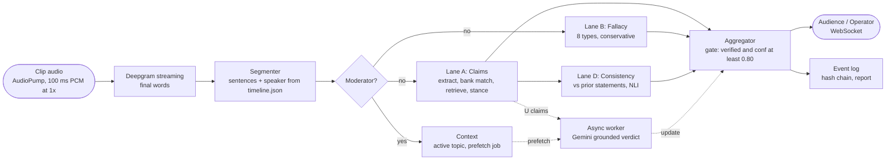

# Debate Agent: Web App Research & Design

What the repo's agent actually does, and a pitch-ready design for the homepage explainer, the synced trimmed-vs-original demo, and the Live beta, with the API the UI needs and what is still to build.

- Source repo: [YanWirdiny/debate-agent](https://github.com/YanWirdiny/debate-agent) (main, as of 14 Nov 2026)
- Companion Page: [Debate Agent: Web App Research & Design](https://cursor.com/canvas/store-dda169ef-c768-4094-84ce-f5aeafbec261/8ef6b940-8316-4495-8399-9582adc01a99)

## Contents

1. [The agent, per the repo](#the-agent-per-the-repo)
2. [Pipeline](#pipeline)
3. [What exists today](#what-exists-today)
4. [Product rules the UI must respect](#product-rules-the-ui-must-respect)
5. [Research: patterns to borrow](#research-patterns-to-borrow)
6. [Site map](#site-map)
7. [1. Homepage: hero and how it works](#1-homepage-hero-and-how-it-works)
8. [2. Demo: trimmed clip synced to the original](#2-demo-trimmed-clip-synced-to-the-original)
9. [3. Live (beta)](#3-live-beta)
10. [Visual direction](#visual-direction)
11. [Components](#components)
12. [Frontend stack](#frontend-stack)
13. [API contract](#api-contract)
14. [Open questions](#open-questions)

---

## The agent, per the repo

| Property | Value |
|---|---|
| Working name | BS Subtitles (BS Debate Checker), per `CONTEXT.md` and the FastAPI title |
| What it does | Live captions of each speaker, with claims underlined in the color of the error they contain and backed by a cited source |
| Inputs | Clip audio (16 kHz WAV) streamed at 1x to Deepgram, plus a hand-corrected `timeline.json` of who speaks when |
| Outputs | WebSocket segments and annotations (7 categories), operator metrics, and a report built from a hash-chained event log |
| Hot path models | Groq JSON mode for claim extraction, stance, fallacy, NLI; local sentence-transformers for claim-bank match |
| Off hot path | Gemini with Google Search for grounded verdicts, per-question prefetch, rolling summary |
| Latency target | 1.5 s from end of sentence to a verified flag; bank hits about 0.6 to 0.9 s (design targets, not measured) |
| Demo clips planned | Trump vs Harris (Sept 2024) and El-Sayed vs Rogers (Michigan Senate, Oct 2026) |
| Stack | Python 3.12, FastAPI, pydantic v2, MongoDB; planned frontend Vite + React + TypeScript + Tailwind + zustand |

> **Warning: repo status (main, 14 Nov 2026).** The pipeline runs end to end only with fake lanes. The real claims, fallacy and consistency lanes, KB, and LLM client are still stubs, and the frontend is just `frontend/src/types.ts`. Any demo page needs recorded runs from real lanes before it can show real flags.

## Pipeline



The prep plane runs before any session: fact-check and transcript sources become a reviewed claim bank, dated past statements, and topic passages in MongoDB, loaded into in-memory numpy at warm-up.

## What exists today

| Piece | Status on main | Matters for the UI because |
|---|---|---|
| Ingest, segmenter, WS hubs, event log, aggregator | ✅ Done | Captions and annotation flow already stream |
| Warm-up, async workers, prefetch, summarizer | ✅ Done (fake lanes) | `ready` and `started` handshake exists |
| `REPLAY_TRANSCRIPT`, `REPLAY_EVENTS`, report JSON and HTML | ✅ Done | A recorded run can drive a public demo |
| economy_v2 clip: timeline + transcript (53.5 s, 9 segments) | ✅ Merged | First demo clip; media files are gitignored |
| Real lanes, KB, LLM client, verify | ❌ Stubs | No real flags yet |
| Second clip (El-Sayed vs Rogers) | ⬜ Not started | Second demo card |
| Frontend | ⚠️ Types only | Everything in this document is new build |
| Trimming / source-video offsets | ⚠️ Not in repo | `clip.json` has no source URL or cut list; needed for sync |

## Product rules the UI must respect

- No scores, rankings, or winner meters: `CONTEXT.md` rule 2 forbids them, so the demo shows flags, never a scoreboard.
- Audience sees verified flags only (confidence 0.80 and evidence); candidates are operator-only.
- Neutral wording: "Contradicted by BLS data (2024)", never "False" or "Liar"; changed positions read "Differs from prior statement (date)".
- Moderator lines appear in muted gray and are never flagged.
- Every color is paired with its letter (color-blind safe): outlined is candidate, solid is verified, struck through is withdrawn or killed.
- Replays must be labeled honestly as replays.

## Research: patterns to borrow

| Pattern | Seen at | How we use it |
|---|---|---|
| Real product UI as the hero, dark canvas, restrained motion | linear.app | Hero is the actual caption bar with flags landing, not stock art |
| Scroll-pinned storytelling, one idea per screen | apple.com/airpods-pro, pudding.cool | How it works: pin the caption, scroll through Hear, Split, Check, Gate, Show, Prove |
| Scrubbed timeline animation tied to scroll | GSAP ScrollTrigger docs | Pipeline beams light up lane by lane as the reader scrolls |
| Animated beams and border glow components | ui.aceternity.com, magicui.design | Data packets travelling STT to lanes to aggregator |
| Node graph with animated edges | reactflow.dev | Interactive architecture view for the pitch deep-dive |
| Live event timeline with markers per incident | flashscore.com, ESPN scoreboard | Scrubber with category ticks; no scoreline, per the no-ranking rule |
| Live claim monitoring and repeat detection | fullfact.org/ai | Repeat badge from `repeat_count`; claim-bank framing in the pitch |
| Speed as a feature | groq.com, deepgram.com | Show the latency budget as a live ticker in operator and Live views |

### References

- [YouTube IFrame Player API reference](https://developers.google.com/youtube/iframe_api_reference) (developers.google.com)
- [YouTube embedded player parameters (start, end, playsinline)](https://developers.google.com/youtube/player_parameters) (developers.google.com)
- [Full debate: Harris vs Trump, 2024 ABC debate (WSJ upload)](https://www.youtube.com/watch?v=VgsC_aBquUE) (youtube.com)
- [Full Fact AI: live monitoring of claims](https://fullfact.org/ai/) (fullfact.org)
- [Factiverse: AI fact-checking](https://www.factiverse.ai) (factiverse.ai)
- [Linear: product-UI-first landing page](https://linear.app) (linear.app)
- [AirPods Pro: scroll-pinned product story](https://www.apple.com/airpods-pro/) (apple.com)
- [The Pudding: visual explainers](https://pudding.cool) (pudding.cool)
- [GSAP ScrollTrigger](https://gsap.com/docs/v3/Plugins/ScrollTrigger/) (gsap.com)
- [Motion for React](https://motion.dev) (motion.dev)
- [React Flow](https://reactflow.dev) (reactflow.dev)
- [Aceternity UI animated components](https://ui.aceternity.com) (ui.aceternity.com)
- [Magic UI](https://magicui.design) (magicui.design)
- [Radix Colors (the repo's category hexes are Radix step 9)](https://www.radix-ui.com/colors) (radix-ui.com)
- [Flashscore live match timelines](https://www.flashscore.com) (flashscore.com)

## Site map

| Route | Purpose | Data source |
|---|---|---|
| `/` | Hero, how it works, demo teaser, Live beta, waitlist | Static + one recorded run for the hero loop |
| `/demo/:clipId` | Synced trimmed clip + original iframe + flag rail | Recorded event log (default) or live operator run |
| `/live` | Beta: waitlist, then live session view | WS `/ws/audience` (to build: live source) |
| `/report/:sessionId` | Shareable post-debate report | `GET /report/{id}` (exists) |
| `/operator` | Team only: start, kill, latency | WS `/ws/operator` (exists) |
| `/method` | Categories, thresholds, sources, eval precision | Static + report methodology |

Top nav: How it works, Demo, Live beta, Method, plus a "Join the beta" button. Operator stays unlisted.

## 1. Homepage: hero and how it works

Hero line idea: **"Every claim, checked before the applause ends."** Under it, a looping caption bar where flags land in real time, a "Watch the demo" button, and a "Join Live beta" button.

### Interactive caption mock (described)

On the Page, a four-step switch (1 Caption, 2 Candidate, 3 Verified, 4 Withdrawn) re-renders a caption bar that shows the last 2 segments. It is rendered from the repo's synthetic fixture segments and their labeled categories, not real debate speech; real clips replace it once lanes land.

| Line | Speaker | Flagged span | Category | Explanation shown when verified |
|---|---|---|---|---|
| 1 | Speaker A | "The unemployment rate is exactly zero percent." | F (Factual error, `#E5484D`) | Contradicted by the synthetic reference (fixture label F) |
| 2 | Speaker A | "My opponent **wears expensive shoes, so their budget cannot work.**" | L (Logical fallacy, `#8E4EC6`) | ad_hominem: attacks the person, not the budget (fixture label L) |

| Step | What the caption shows |
|---|---|
| 1 Caption | Plain text, no underline, no chip |
| 2 Candidate | Dashed underline in the category color + outlined letter chip (operator view only in the real product) |
| 3 Verified | Solid underline + filled letter chip + one-line explanation |
| 4 Withdrawn | Span struck through, chip faded |

### How it works: six pinned scroll screens

1. **Hear**: Audio streams to Deepgram; a waveform turns into words, timestamped from clip start.
2. **Split**: Sentences get a speaker from the timeline; moderator questions set the topic and trigger prefetch.
3. **Check, three lanes at once**: Claims (bank match or retrieve + stance), Fallacy (8 types), Consistency (vs dated past statements).
4. **Gate**: Code checks spans and quotes verbatim; only verified flags at 0.80 confidence or more reach the audience.
5. **Show**: Span underlined in its category color with a letter chip; tap for explanation, quote, source, date.
6. **Prove**: Every event is hash-chained into a log; the report and replays read only from it.

Each step is one pinned scroll screen: the caption stays fixed while the pipeline graph beside it lights the active stage, beams carry a sentence from node to node, and a latency counter ticks against the 1.5 s budget.

## 2. Demo: trimmed clip synced to the original

### Layout

| Area | Element | Detail |
|---|---|---|
| Main stage | Original video (YouTube iframe) | What the viewer watches, full width, captions and flags overlaid under it |
| Agent feed | Trimmed clip ("agent's ear") | Small picture-in-picture labeled "Agent is listening"; runs ahead of the main stage |
| Lead meter | "Agent is N s ahead" | Live gap between what the agent has processed and what the viewer hears |
| Side rail | Flag feed | Speaker, timestamp, chip; late async verdicts arrive here, per the repo's caption rules |
| Scrubber | Timeline with category ticks | Cut regions shaded as "Not analyzed (outside excerpt)" |

Both players start on one click. The agent consumes the trimmed audio at 1x; the original keeps the parts that were cut, so the viewer reaches each sentence later than the agent does. Every flag is shown when the original reaches the mapped time, so it lands as the sentence is heard.

### Mapping and lead

```
orig(t) = o_i + (t − a_i)        for a_i ≤ t ≤ b_i   (piece i of the cut list)
lead    = orig(t_end) − t_end / speed − latency
```

- `a_i, b_i`: start and end of kept piece *i* in the trimmed clip
- `o_i`: where that piece starts in the original window
- `speed`: agent playback speed on the trimmed audio (1x today)
- `latency`: time from end of sentence to flag ready

### Lead per sentence (economy_v2, illustrative cuts)

> **Illustrative.** Segment times are real (economy_v2 transcript). The cut list (6 s, 20 s, 8 s removed in an 87.5 s window) is invented to show the mechanism, because the repo stores no source offsets. Agent speed above 1x uses the existing `speed` parameter of AudioPump and replay, which no API exposes yet and which is untested with Deepgram streaming.

**Illustrative cut list (EDL):**

| Piece | Trimmed range | Original range | Cut after it |
|---|---|---|---|
| 1 | 0.00 to 4.08 s | 0.00 to 4.08 s | 6 s |
| 2 | 4.08 to 27.00 s | 10.08 to 33.00 s | 20 s |
| 3 | 27.00 to 38.75 s | 53.00 to 64.75 s | 8 s |
| 4 | 38.75 to 53.50 s | 72.75 to 87.50 s | – |

Trimmed length 53.5 s; original window 87.5 s (34 s cut).

```mermaid
gantt
  title Trimmed clip mapped onto the original window (illustrative)
  dateFormat X
  axisFormat %M:%S
  section Original (viewer)
  Piece 1        :o1, 0, 4s
  cut 6 s        :crit, 4, 6s
  Piece 2        :o2, 10, 23s
  cut 20 s       :crit, 33, 20s
  Piece 3        :o3, 53, 12s
  cut 8 s        :crit, 65, 8s
  Piece 4        :o4, 73, 15s
  section Trimmed (agent)
  Piece 1        :t1, 0, 4s
  Piece 2        :t2, 4, 23s
  Piece 3        :t3, 27, 12s
  Piece 4        :t4, 39, 15s
  Agent done, viewer still watching :done, 54, 34s
```



*(Mermaid gantt rounds to whole seconds; the tables carry the exact values.)*

**Interactive chart (described).** On the Page, two switches set the latency path (Bank hit 0.9 s, Hot path 1.5 s, Grounded 20 s) and the agent speed (1x, 1.25x, 1.5x). The chart draws the original track on top with kept pieces and gray "cut" gaps, the trimmed track below with shaded connectors to where each piece lands in the original, and a dashed box after 53.5 s labeled "agent done, viewer still watching". For each sentence, a dot marks when the viewer hears its end and a triangle marks when the flag is ready; the line between them is the lead (yellow when early, red when late). A table under it lists the lead per sentence. All nine settings are below, so nothing is lost without the switches.

**Lead per sentence = time the viewer hears the sentence end minus time the flag is ready (positive = flag ready first).**

| Segment | Speaker | Ends (trimmed) | Heard (original) | Bank 0.9 s, 1x | Hot 1.5 s, 1x | Grounded 20 s, 1x | Hot 1.5 s, 1.25x | Hot 1.5 s, 1.5x | Grounded 20 s, 1.5x |
|---|---|--:|--:|--:|--:|--:|--:|--:|--:|
| economy_v2:1 | harris | 13.8 s | 19.8 s | +5.1 s | +4.5 s | −14.0 s | +7.3 s | +9.1 s | −9.4 s |
| economy_v2:2 | harris | 26.9 s | 32.9 s | +5.1 s | +4.5 s | −14.0 s | +9.9 s | +13.5 s | −5.0 s |
| economy_v2:3 | trump | 29.0 s | 55.0 s | +25.1 s | +24.5 s | +6.0 s | +30.3 s | +34.2 s | +15.7 s |
| economy_v2:4 | trump | 38.8 s | 64.8 s | +25.1 s | +24.5 s | +6.0 s | +32.2 s | +37.4 s | +18.9 s |
| economy_v2:5 | trump | 41.8 s | 75.8 s | +33.1 s | +32.5 s | +14.0 s | +40.9 s | +46.4 s | +27.9 s |
| economy_v2:6 | trump | 45.9 s | 79.9 s | +33.1 s | +32.5 s | +14.0 s | +41.7 s | +47.8 s | +29.3 s |
| economy_v2:7 | trump | 49.1 s | 83.1 s | +33.1 s | +32.5 s | +14.0 s | +42.3 s | +48.9 s | +30.4 s |
| economy_v2:8 | trump | 53.3 s | 87.3 s | +33.1 s | +32.5 s | +14.0 s | +43.2 s | +50.3 s | +31.8 s |

Sentences with the flag ready before the viewer hears the end: 8 of 8 on the bank and hot paths at any speed; 6 of 8 on the grounded path at any speed (the two Harris sentences come before the big cut, so a 20 s verdict lands late and goes to the side rail). The moderator segment (economy_v2:0) is never flagged and is left out.

### Sync mechanism

```mermaid
sequenceDiagram
  participant U as Viewer
  participant FE as Demo page
  participant YT as YouTube iframe
  participant BE as Backend
  Note over FE: Page load: GET clip manifest, preload trimmed clip, cue iframe at window start (paused)
  U->>FE: click Start (user gesture unlocks autoplay)
  FE->>BE: start (or begin recorded replay)
  BE-->>FE: started, t0_wall
  FE->>YT: seekTo(window_start), playVideo()
  Note over FE: Trimmed video plays from 0 at t0; every 250 ms map flags to orig(t) and compare with getCurrentTime()
  BE-->>FE: segment / annotation / update / removal
  FE->>U: flag pops when iframe time passes orig(t_end)
```

```ts
// Flags are keyed to VIDEO time, not wall time, so ads, buffering and seeks can't desync them.
const orig = (t: number) => {
  const p = edl.find(p => t >= p.trim_start && t <= p.trim_end) ?? edl[edl.length - 1];
  return p.orig_start + (t - p.trim_start);           // seconds in the YouTube video
};

setInterval(() => {
  const now = player.getCurrentTime();                 // IFrame API
  for (const a of pendingAnnotations) {
    const seg = segments[a.segment_id];
    if (now >= orig(seg.t_end)) reveal(a);             // underline + chip + rail entry
  }
  // Agent feed drift check (repo rule: seek if drift > 300 ms)
  const expected = (Date.now() / 1000 - t0_wall) * speed;
  if (Math.abs(trimmedVideo.currentTime - expected) > 0.3) trimmedVideo.currentTime = expected;
  // Viewer in a cut region: show "Not analyzed (outside excerpt)"
  setInCut(!edl.some(p => now >= p.orig_start && now <= p.orig_start + (p.trim_end - p.trim_start)));
  setLead(orig(processedUpTo) - now);                  // "Agent is N s ahead"
}, 250);
```

### Edge cases

| Case | Handling |
|---|---|
| Autoplay blocked | Start only from a click; iframe muted until unmute; listen for `onAutoplayBlocked` |
| Ad or buffering in the iframe | Flags wait for video time, so nothing desyncs; lead meter pauses |
| Viewer seeks back | Re-show flags already revealed for that range |
| Viewer seeks past the agent | Scrubber shows the agent frontier; region shimmers as "Agent still listening" |
| `start` param snaps to a keyframe | Per YouTube docs; `seekTo` after ready, then re-anchor from `getCurrentTime()` |
| Embedding disabled or video removed | Fall back to a self-hosted original or a trimmed-only mode |
| Grounded verdict lands after the line is gone | Goes to the side rail with timestamp, per the repo's caption rule |
| Annotation withdrawn or killed | Strike through in place and in the rail; never silently delete |
| Playback rate changed | Respond to `onPlaybackRateChange`; flags still key off video time |
| Phone | Stack: original first, agent feed as a strip, rail as a bottom sheet; `playsinline=1` |

## 3. Live (beta)

1. **Beta label everywhere**: A Beta tag on nav and player; one line: verified flags only, some claims will be missed.
2. **Waitlist**: Name and email plus which debate or event they want covered.
3. **Try it**: Scheduled sessions run by the team's operator; viewers join the audience view.
4. **Watch**: Live captions, flags, topic chip from the moderator's question, latency ticker, "Pending" state for slow lanes.
5. **After**: One click to the report page built from the event log.

> **Warning: not built yet.** Ingest today only reads a clip file; a room or stream source (one mic per participant is marked stretch in `CONTEXT.md`) and per-viewer session handling are needed before Live can open beyond the operator.

## Visual direction

**Category palette (from `CONTEXT.md`; Radix step-9 colors):**

| Code | Category | Hex |
|---|---|---|
| F | Factual error | `#E5484D` (red) |
| M | Misleading | `#F76B15` (orange) |
| D | Data misuse | `#FFB224` (amber) |
| L | Logical fallacy | `#8E4EC6` (purple) |
| C | Differs from prior statement | `#0090FF` (blue) |
| U | Unverifiable | `#8B8D98` (gray) |
| V | Verified | `#30A46C` (green) |

- Base: near-black broadcast canvas, off-white text; the seven category colors are the only saturated color, so color always means a finding.
- Signature: a thin seven-color strip (F to V) used as the logo underline, section dividers and the loading bar.
- Type: a geometric sans for headlines and UI, and a mono for timestamps, latency and letter chips.
- Motion: underline draws left to right on verify, outline fills to solid, strike animates on withdraw; beams for data flow; honor `prefers-reduced-motion`.
- Tone: newsroom, not esports; calm, sourced, neutral copy that matches the repo's wording rules.

## Components

| Component | Where | Notes |
|---|---|---|
| CaptionBar | Hero, demo, live | Planned in repo; last 2 segments, speaker always visible |
| FlagChip | Everywhere | Planned in repo; letter + color, outlined/solid/struck |
| EvidencePopover | Demo, live, report | Planned in repo; explanation, quote, source, date |
| SideRail | Demo, live | Planned in repo; late verdicts and history |
| LatencyMeter | Operator, live | Planned in repo; p50/p95, bank hit rate |
| PipelineExplainer | Home | New; pinned scroll scenes + animated graph |
| SyncedStage | Demo | New; YouTube player + trimmed video + EDL mapper |
| LeadMeter | Demo | New; "Agent is N s ahead" |
| TimelineScrubber | Demo, report | New; category ticks, cut regions shaded |
| ClipCard | Home, demo picker | New; title, duration, speakers, Replay or Live label |
| BetaBadge + WaitlistForm | Live | New; name and email only |

## Frontend stack

| Layer | Pick | Why |
|---|---|---|
| App | Vite + React + TypeScript | Already the repo's plan; `types.ts` exists |
| Styling | Tailwind + shadcn/ui (Radix) | Plan says Tailwind; category hexes are Radix colors |
| State | zustand | Planned `store.ts`: segments, annotations, metrics, clock |
| Routing | React Router | Routes above; no SSR needed for a demo |
| Motion | Motion for React; GSAP ScrollTrigger for pinned scenes | Component transitions plus scroll scrubbing |
| Video | YouTube IFrame API + native video element | Original via embed, trimmed clip self-hosted |
| Diagram | Hand SVG (or React Flow for the deep-dive) | Full control of beams and timing |

If the landing page needs SEO and link previews for the pitch, Next.js is the alternative; it costs a second setup next to the planned Vite app.

## API contract

| Need | Endpoint or message | Status | Notes |
|---|---|---|---|
| List clips | `GET /clips` | ✅ Exists | `clip_id`, `title`, `duration` only |
| Clip manifest for sync | `GET /clips/{id}` | 🔨 Build | add `youtube_id`, `window_start`, `window_end`, `edl[]`, speakers, poster |
| Trimmed media | `GET /media/{clip_id}/clip.mp4` | 🔨 Build | no static route today; needs range requests (or a CDN) |
| Audience stream | WS `/ws/audience` | ✅ Exists | `segment`, `annotation`, `annotation_update`, `removal`, `started` |
| Operator control | WS `/ws/operator`: `load`, `start`, `kill` | ✅ Exists | replies `ready`, `started`, `banner`, `pending`, `metrics` |
| Public demo start | replay of a recorded run per viewer | 🔨 Build | today one session per process, started only by operator |
| Recorded run events | `GET /sessions/{id}/events` | 🔨 Build | event log exists; lets the browser replay offline |
| Sessions | `GET /sessions` | ✅ Exists | pick the recorded run per clip |
| Report | `GET /report/{id}` and `.html` | ✅ Exists | deterministic, from event log |
| Agent speed | `speed` on `load` or `start` | 🔨 Build | AudioPump and replay accept speed; not exposed |
| Agent progress | `processed_until` in metrics or a tick message | 🔨 Build | drives the lead meter |
| Waitlist | `POST /waitlist` | 🔨 Build | name, email, event |
| Live source | room or stream ingest | 🔨 Build | stretch in `CONTEXT.md` |

## Open questions

1. Which original videos? Is the WSJ upload of the ABC debate the source for economy_v2, and what are the exact cut points (the cut list is the key input for sync)?
2. Should the public demo play recorded runs (reliable, cheap) and keep live runs for pitch day only?
3. Do you want the agent to run faster than 1x on trimmed audio for extra lead, or rely on the cut gaps alone?
4. Note: the repo forbids scoring and ranking speakers (`CONTEXT.md` rule 2), so the design shows flags only, with no scores or winner meters. Keep that rule on the site?
5. Vite SPA as planned, or Next.js for the landing page?
6. Is the product name BS Subtitles, Debate Agent, or something new for the pitch?
7. Hosting and rights: is it fine to self-host the trimmed clip next to an official embed?
